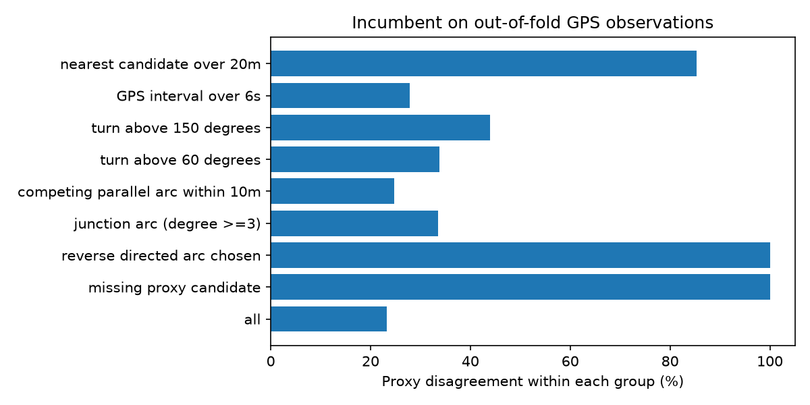

# PathSnap development experiments

## Selection and evidence

The earlier 40-stage experiment log includes five original classifier families, Random Forest, class weighting, candidate and feature ablations, eight Optuna TPE trials and decoder sensitivity. The previous winner used logistic regression with C=0.011825176269334062. See [historical audit](../FINAL_VALIDATION_AUDIT.md) and [stage evidence](../results_improved/experiments.json).

The final benchmark crosses eight feature/candidate/classifier settings with four decoding settings (32 runs). Each uses the same three GroupKFold splits of 80 training trips (27/27/26). Every fifth training fix is sampled; validation uses every fix. CV averages metrics within trip, within fold and then equally over folds. Student-test averages over ten trips. Arc macro metrics average over the union of predicted and observed classes within the trip. Sequence similarity compares collapsed directed arc sequences. Continuity counts same-arc or directed-adjacent transitions across intervals of at most 15 seconds. Candidate log loss measures eligible binary candidate scores. Timing in the experiment CSV measures prediction and decoding after feature preparation, averaged over trips; training seconds sum the three fit calls. API timing includes trip preparation.

Primary routing selection maximized agreement subject to the incumbent Macro F1 and 98% continuity floors. A secondary comparison selected maximum agreement subject to the same Macro F1 floor and disclosed its continuity cost. The second objective was added after observing training-fold results, so it is exploratory. Development-test results were already known historically and the ten trips are not an untouched external test. No evaluator data entered the benchmark. The grouped search is non-nested.

| Pipeline | CV agreement | CV Macro F1 | CV continuity | Student agreement | Student Macro F1 | Student weighted F1 | Macro precision | Macro recall | Sequence similarity | Student continuity |
|---|---:|---:|---:|---:|---:|---:|---:|---:|---:|---:|
| Original | 0.7436 | 0.5967 | 0.9917 | 0.7865 | 0.6278 | 0.8206 | 0.6727 | 0.6152 | 0.6754 | 0.9960 |
| Improved | 0.8328 | 0.7537 | 0.9903 | 0.8570 | 0.7575 | 0.8763 | 0.7860 | 0.7510 | 0.8007 | 0.9955 |
| Forest | 0.8642 | 0.8222 | 0.9800 | 0.8884 | 0.8335 | 0.9057 | 0.8487 | 0.8313 | 0.8186 | 0.9841 |
| Refined logistic | 0.9158 | 0.9070 | 0.9384 | 0.9428 | 0.9263 | 0.9573 | 0.9328 | 0.9243 | 0.8506 | 0.9446 |

## What changed performance

- On the same 16-candidate search the four-feature logistic classifier scored .5817 CV Macro F1, six features .6932 and ten features .7239. The ten-feature forest attained .7597 before sequence decoding. Its held-in classifier agreement was 85.61% versus 84.80% held out. Inspect training gaps and eligible-candidate log loss for each configuration in the CSV.
- The transformed distance is log(1 + segment distance in metres), which gives close matches more resolution. Relative distance subtracts the nearest eligible arc distance, measuring competition. Signed endpoint clearance takes the minimum projected longitudinal distance to either endpoint and clips to ±50 m; negative values indicate overshoot. Local support averages exp(−distance/12 m) from up to two neighbouring fixes in either direction within 6 s. Only support uses future fixes among these four. Original heading and speed use past motion; forward heading uses one future fix and smoothed heading up to two. These features are available for batch inference and require delayed output for streaming. No feature looks across trips or uses reference arcs.
- The wider 20-candidate, 45 m search increased CV recall from 97.29% to 97.59% and mean candidates from 7.05 to 9.13. Neither winner required the extra candidates. Candidate recall on the ten student trips was 98.60% originally and 99.82% for the newer 16-candidate bundles.
- The forest uses 36 trees, max depth 13 and minimum leaf size 5. Its decoder uses motion weight 1.5, jump penalty 4, 6 s gap resets and an additional disconnected endpoint-distance penalty capped at 4, scaled by 15 m. This promotes shorter jumps without computing a shortest road path.
- With the same six-feature logistic classifier, standard motion decoding scored .7537 CV Macro F1, endpoint penalties .7552, and snapping to arcs on the model's own decoded route .9070. The refinement uses the earliest predicted encounter to resolve exact distance ties. It mirrors the *geometry of the proxy definition* and may prefer the wrong direction or disconnect nearby fixes. Its 94.28% development agreement measures agreement with that proxy. True per-fix accuracy and official evaluator performance are unknown.
- Random forest, Extra Trees, histogram gradient boosting and logistic regression ran in the new comparison. Historic TPE covered logistic regularization; the new search checked the incumbent C and C=1. XGBoost and LightGBM imports failed on a missing OpenMP runtime. CatBoost was unavailable. Kernel SVM and per-candidate probability calibration were deprioritized because of fit cost and the available grouped candidate log-loss comparisons. No external packages were installed for the search.

## Failure analysis

The incumbent disagreed on 48,383 of 208,417 held-out training fixes when pooling all observations. This pooled rate weights long trips more heavily than the equal-trip development comparison above. In 23,393 errors the proxy arc was absent from the eligible candidates. On 11,961 fixes it chose the reverse arc. Junctions and turns over 150° had disagreement rates of 33.47% and 43.92% respectively. Conditions overlap; a large residual or sharp GPS reversal is evidence of ambiguity, not a verified noise event or physical U-turn. Loop-specific ground truth is unavailable. [Condition counts](error_conditions.csv)

## Reproduction files

The [experiment CSV](../results_final/experiments.csv) records every configuration, seed, fit time, metrics and validation method. [Per-trip CV](../results_final/cv_trips.csv), [fold membership](../results_final/folds.json) and [environment](../results_final/environment.json) support independent checks. The two selections are stored before their corresponding full-data fits. The development outputs include [forest trips](../results_final/student_trips.csv) and [refined logistic trips](../results_final/agreement/student_trips.csv). Use the commands in the [README](../README.md).

A fresh run of the final script reproduced all 32 non-timing summary rows, all 2,560 held-out trip rows and both ten-trip result tables to absolute tolerance 1e-10. The original and improved joblib artifacts matched their archived SHA-256 values. [Combined historical and research experiment table](all_experiments.csv)

## Release checks

A clean editable install in a fresh Python 3.14 environment succeeded. Pip reported consistent dependencies. All nine discovered tests passed, including 40 student-test API regressions (four saved bundles across all ten trips), both inference modes on a synthetic reference-free trip, malformed input, missing trip, CORS, feature extraction, candidate search, decoding and metric agreement with scikit-learn. Starlette emitted a deprecation warning about its httpx TestClient adapter.

Headless Chrome loaded the served dashboard, fetched a synthetic trip, requested both prediction modes over HTTP and rendered the selected model and both sets of metrics. This exercised separate UI and API ports and a configurable API address on a single host. Physical two-laptop networking and official scoring were not tested. An older generated development HTML map containing student geometry was removed from the branch tip. Previous remote commits still contain its history; no history was rewritten.
